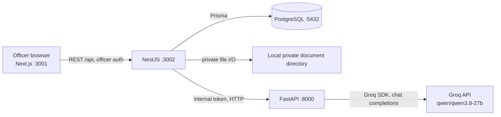

# Janaseva AI

Janaseva AI is a Kannada-first demonstration application for organizing the
review of Karnataka income-certificate applications. It gives officers a
shared workspace for application records, document checks, field verification,
final review, reports, and recorded activity.

> **Demonstration only.** This is not an official Karnataka government portal,
> does not connect to government systems, and must not be used to process real
> applications. Seed and fixture records are synthetic.

## What problem does it demonstrate?

Paper files, repeated document requests, disconnected field reports, and
unclear handoffs can make it difficult for staff to tell what an application
needs next. Janaseva AI demonstrates a structured workflow and a shared record
of document versions, verification actions, field reports, review decisions,
and history. It is a take-home assignment prototype, not a measured
government-service improvement.

The interface is intended for caseworkers, field-level VA/RI officers,
authorized reviewing officers, and administrators. Citizens are potential
beneficiaries of clearer status and follow-up information; **there is no
citizen-facing application portal or application-submission flow**.

## Features and implementation status

| Area                           | Current implementation                                                                                                                                                                                                                                          |
| ------------------------------ | --------------------------------------------------------------------------------------------------------------------------------------------------------------------------------------------------------------------------------------------------------------- |
| Dashboard and application list | Dashboard summaries, attention items, activity widgets, searchable/paged applications and workflow filters.                                                                                                                                                     |
| Application workspace          | Loads application details and joins document, field, history, Final Review, and AI panels. Some demonstration presentation state is client-side.                                                                                                                |
| Document verification          | Uploads PDF/JPEG/PNG files up to 10 MB, stores version metadata, previews files, records verify/reject/replacement/missing-document actions, and recalculates application status.                                                                               |
| Field verification             | Supports assignment, scheduling/rescheduling, starting visits, draft reports, checklist submission, follow-up, and activity history. Its “assist” endpoint is deterministic demonstration guidance, not the Groq model.                                         |
| Final Review                   | Calculates blockers and supports `APPROVE`, `REJECT`, and `RETURN_FOR_CORRECTION` for authorized officers/admins. Decision and status update are written in one Prisma transaction. A live database decision has not been independently verified in this audit. |
| Reports and analytics          | Database-backed filters, paged application rows, aggregates, submission trend, and CSV export. Overdue count is not calculated.                                                                                                                                 |
| History                        | Combines persisted document, field, and decision activities with a submission entry derived from the application record. CSV export is available.                                                                                                               |
| AI application analysis        | Real Groq-backed structured analysis is implemented through NestJS and FastAPI. A synthetic English/Kannada flow was previously exercised through the provider, API layers, and browser; see [AI analysis](#ai-application-analysis).                           |
| Language                       | Kannada is the default; English is supported. Preference is saved in browser local storage and a cookie.                                                                                                                                                        |
| Notifications                  | No notification delivery feature is implemented.                                                                                                                                                                                                                |

This table describes code and the recorded test evidence; it does not certify
production readiness.

## Pages

| Route                    | Purpose                                                                                                    |
| ------------------------ | ---------------------------------------------------------------------------------------------------------- |
| `/`                      | Dashboard overview, summary widgets, attention queue, recent activity, and quick actions.                  |
| `/applications`          | Searchable, sortable, paged application list with workflow filtering.                                      |
| `/document-verification` | Verification queue and document upload/review actions.                                                     |
| `/field-verification`    | Field officer queue and visit/report workflow.                                                             |
| `/final-review`          | Eligibility-aware review queue and officer decision form.                                                  |
| `/reports`               | Filtered reporting, aggregates, trends, and CSV download.                                                  |
| `/history`               | Filtered activity timeline and CSV download.                                                               |
| `/settings`              | Officer/profile and application information presentation; not account provisioning or identity management. |
| `/applications/[id]`     | Workspace for one application, including documents, field work, history, Final Review, and AI analysis.    |

Unknown section names are rendered as not-found pages.

## End-to-end workflow

1. **Application record exists.** There is no intake endpoint. The standard
   seed inserts synthetic applications; the Final Review demonstration
   application is an explicit, optional SQL fixture.
2. **Document review.** A caseworker or other permitted officer inspects
   submitted files and metadata. The service records document versions,
   verifies or rejects versions, marks replacements/missing information, and
   recalculates the application document status.
3. **Field verification.** A caseworker/authorized officer/admin can assign
   and schedule a visit. A VA/RI officer (or an authorized reviewer/admin)
   records a draft checklist/report and submits it. The service checks that
   required documents are verified before visit actions. A report requesting
   follow-up remains in field verification; an otherwise complete submitted
   report can advance the application to `FINAL_REVIEW`.
4. **Final Review.** The backend checks workflow stage, required document
   versions, and the submitted field report/checklist, then returns any
   blockers. `AUTHORIZED_OFFICER` or `ADMIN` can submit an approval, rejection,
   or return-for-correction decision. Reject and return require remarks.
   Approval/rejection move the application to `COMPLETED`; return moves it
   back to `DOCUMENT_VERIFICATION`. A return does not send an applicant
   notification.
5. **History and reporting.** Document and field actions and decisions are
   stored. History reads those events and adds a submission event derived from
   the application row. Reports calculate filtered totals, summaries, and
   trends from the database.
6. **Optional AI assistance.** An officer can request a structured,
   evidence-based summary and suggested questions in Kannada or English. AI
   output does not update the application or make a decision.

The application is a demonstration of a workflow, not an implementation of
official eligibility rules. In particular, Final Review policy should be
confirmed before any real-world use.

## Architecture



The browser calls NestJS, not FastAPI directly. FastAPI is intended to be
reachable only on a private/local network. Docker Compose in this repository
starts PostgreSQL only; it does not containerize or start the application
services.

### Technology stack

- **Frontend:** Next.js App Router, React, TypeScript, Tailwind CSS, Lucide
  icons.
- **Backend:** Node.js, NestJS, TypeScript, REST, Prisma.
- **AI service:** Python, FastAPI, Pydantic, official Groq Python SDK.
- **Database:** PostgreSQL. pgvector is not configured or used.
- **Local infrastructure:** Docker Compose for PostgreSQL.

### Repository structure

```text
frontend/       Next.js pages, dashboard components, API clients, translations
backend/        NestJS modules, Prisma schema/migrations/seed, backend tests
ai-service/     FastAPI app, Groq adapter, Pydantic schemas, Python tests
docs/           Project notes (review for freshness against this README)
qa-output/      Staged QA report, screenshots, and CSV exports
docker-compose.yml
.env.example
README.md
```

The checked-out Git index currently contains staged files but the `main` branch
has no commit yet. Review `qa-output/` before publishing; the screenshots and
CSV exports are generated artifacts and may contain synthetic application
details.

## Local prerequisites

- Node.js 22 or later and npm.
- Python 3.11 or later.
- Docker with the Compose plugin.
- A Groq API key only for live AI analysis. Model availability and free-plan
  rate limits are controlled by Groq.

## Environment configuration

Never commit `.env` files or put secrets in frontend variables. The checked-in
templates use placeholders. The root `.gitignore` ignores `.env` files.

| Variable                                            | Service            | Purpose                                                                                                 |
| --------------------------------------------------- | ------------------ | ------------------------------------------------------------------------------------------------------- |
| `POSTGRES_USER`, `POSTGRES_PASSWORD`, `POSTGRES_DB` | Docker Compose     | Local PostgreSQL initialization; use local-only credentials.                                            |
| `DATABASE_URL`                                      | Prisma/NestJS      | PostgreSQL connection. Encode reserved URL characters in passwords.                                     |
| `PORT`                                              | NestJS             | HTTP port; defaults to `3002` in local instructions.                                                    |
| `FRONTEND_ORIGIN`                                   | NestJS             | Allowed browser CORS origin; local value is `http://localhost:3001`.                                    |
| `AI_SERVICE_URL`                                    | NestJS             | FastAPI base URL; code defaults to `http://127.0.0.1:8000`. Not currently listed in `.env.example`.     |
| `AI_SERVICE_TOKEN`                                  | NestJS and FastAPI | Shared internal service credential. Generate a separate random value; do not reuse the Groq key.        |
| `DOCUMENT_VERIFICATION_JWT_SECRET`                  | NestJS             | At least 32 bytes, used to validate officer HS256 tokens when demo authentication is disabled.          |
| `DOCUMENT_VERIFICATION_JWT_ISSUER`                  | NestJS             | Expected officer JWT issuer; local template uses `janaseva-ai-auth`.                                    |
| `DOCUMENT_VERIFICATION_DEMO_AUTH_ENABLED`           | NestJS             | Local demo-header auth control. Must be disabled in production.                                         |
| `DOCUMENT_STORAGE_PATH`                             | NestJS             | Private local document directory; defaults to `.private-documents` under the backend working directory. |
| `NEXT_PUBLIC_API_BASE_URL`                          | Next.js            | Browser-visible NestJS origin; local default is `http://localhost:3002`.                                |
| `NEXT_PUBLIC_DOCUMENT_VERIFICATION_DEMO_AUTH`       | Next.js            | Enables the development demo header; set to `false` when using a token.                                 |
| `AI_PROVIDER`                                       | FastAPI            | Active provider; currently `groq`.                                                                      |
| `GROQ_API_KEY`                                      | FastAPI            | Secret Groq API key. Keep server-side only.                                                             |
| `GROQ_MODEL`                                        | FastAPI            | Current model is `qwen/qwen3.8-27b`.                                                                    |
| `GROQ_API_BASE_URL`                                 | FastAPI            | OpenAI-compatible API URL; defaults to `https://api.groq.com/openai/v1`.                                |

The root `.env.example` is used by Compose and can be copied to `backend/.env`
for local NestJS/Prisma configuration. Create `ai-service/.env` from
`ai-service/.env.example`. Next.js reads its own environment; if overriding
defaults, place only the two `NEXT_PUBLIC_*` settings in
`frontend/.env.local`. Do not copy database credentials or private tokens into
frontend configuration.

## Local setup

### 1. Configure and start PostgreSQL

From the repository root:

```bash
cp -n .env.example .env
```

Edit `.env` locally, then copy its database/backend settings without
overwriting an existing backend configuration:

```bash
cp -n .env backend/.env
docker compose up -d postgres
```

The Compose service exposes PostgreSQL on `localhost:5432` and persists data
in the `postgres_data` named volume.

### 2. Install, migrate, seed, and start NestJS

```bash
cd backend
npm ci
npm run prisma:generate
npm run prisma:migrate:deploy
npm run prisma:seed
npm run start:dev
```

The normal seed inserts synthetic users, income-certificate requirements, and
application records. It does **not** make an eligible Final Review example.
To add the isolated local review example after migrations and seed, run this
from `backend/`:

```bash
npx prisma db execute --file prisma/fixtures/final-review-demo.sql
```

Use the fixture only with a disposable local/demo database. It is not run by
migrations or by the normal seed.

### 3. Install and start the frontend

In another terminal:

```bash
cd frontend
npm ci
npm run dev
```

Open <http://localhost:3001>.

### 4. Install and start FastAPI

Create `ai-service/.env` using `ai-service/.env.example`, configure the Groq
key locally, and set the same `AI_SERVICE_TOKEN` as in `backend/.env`.
From the repository root:

```bash
cd ai-service
python3.11 -m venv .venv
source .venv/bin/activate
python -m pip install -e ".[dev]"
uvicorn app.main:app --reload --host 127.0.0.1 --port 8000
```

FastAPI binds to loopback in this development command; do not expose it
directly to the public internet.

## Local URLs and health checks

| Service                        | Local address              | Health/check                                                                         |
| ------------------------------ | -------------------------- | ------------------------------------------------------------------------------------ |
| Next.js frontend               | <http://localhost:3001>    | No dedicated health endpoint.                                                        |
| NestJS backend                 | <http://localhost:3002>    | `GET http://localhost:3002/health` also checks PostgreSQL.                           |
| PostgreSQL                     | `localhost:5432`           | Compose `pg_isready` health check.                                                   |
| FastAPI                        | `http://127.0.0.1:8000`    | `GET http://127.0.0.1:8000/health`.                                                  |
| FastAPI provider configuration | FastAPI `/provider-status` | Requires `X-Janaseva-AI-Service-Token`; `CONFIGURED` is not a live-generation check. |

## Authentication and demo access

In non-production development, the frontend sends the demo-auth header by
default unless `NEXT_PUBLIC_DOCUMENT_VERIFICATION_DEMO_AUTH=false`. NestJS
accepts it only outside production and resolves a seeded active user. The
normal demo identity is a caseworker; Final Review provides a reviewer/admin
selection for its demo decision actions. The caseworker cannot submit a final
decision.

There is no production login UI or trusted token issuer in this repository.
Production routes require a valid HS256 bearer token for an active database
officer, with the configured issuer and secret. The local
`npm run auth:issue-demo-token` command creates a short-lived development
caseworker token; it is not a production issuer.

## AI application analysis

The request path is:

1. Frontend sends `POST /api/applications/:applicationId/ai-analysis` to
   NestJS.
2. NestJS reads structured application, document, missing-information, and
   field-verification data from PostgreSQL; it excludes selected identity and
   address fields and redacts common identifiers in relevant free text.
3. NestJS calls authenticated FastAPI `POST /analyze/application` with the
   internal service token.
4. FastAPI validates the request, calls Groq chat completions with the
   configured model and structured response schema, then validates the model
   response.
5. NestJS validates the response again; the frontend displays the summary and
   findings. Analysis is not persisted and does not change application status.

The current provider is Groq, model `qwen/qwen3.8-27b`. Qwen instruct settings
are used to avoid spending the output budget on reasoning. The configured
limits are 40 seconds for Groq, 45 seconds for FastAPI, 55 seconds for the
NestJS-to-FastAPI request, and 65 seconds for the frontend; Groq SDK retries
are disabled and the structured response is capped at 1,024 completion
tokens. The provider-status endpoint reports configuration without generating
text unless an explicit connectivity check is requested.

**AI is advisory only.** The authorized officer must independently verify
findings and make the final decision. AI cannot approve, reject, return, or
modify an application. Uploaded document bytes are not sent to Groq.

**Recorded live test evidence:** a synthetic Kannada analysis was successfully
validated through the direct provider request, authenticated FastAPI endpoint,
authenticated NestJS endpoint, and the browser Analyze action. The response
contained the expected summary, missing-information, inconsistency, document,
field, suggested-question, officer-attention, and disclaimer fields. This is
not a test with real applicant data. Automated Python tests mock provider
responses and do not consume Groq quota.

The separate `/api/field-verification/assist` route is deterministic
demonstration guidance, not Groq analysis.

## Tests and checks

There is no root-level test runner. Run the existing service commands:

```bash
# Frontend
cd frontend
npm run lint
npm run format:check
npx tsc --noEmit
npm run build
cd ..

# Backend unit tests, lint, formatting, type check, and build
cd backend
npm test
npm run lint
npm run format:check
npx tsc --noEmit
npm run build
cd ..

# Backend e2e tests (Vitest/Supertest; some providers are mocked)
cd backend
npm run test:e2e
cd ..

# FastAPI
cd ai-service
.venv/bin/ruff check .
.venv/bin/ruff format --check .
.venv/bin/pytest
```

**Latest QA run:** Frontend lint, formatting, TypeScript, and production build
passed. Backend lint, formatting, TypeScript, production build, and unit tests
passed (57 tests); all 9 backend e2e tests passed after updating the stale AI
response fixture to match the current disclaimer contract. FastAPI Ruff lint
and formatting passed, as did all 25 Python tests. A local browser walkthrough
loaded all nine implemented routes at desktop and mobile widths without
horizontal overflow. One real synthetic Kannada analysis returned HTTP 201
and rendered all expected fields and the advisory disclaimer. This does not
replace a complete isolated database workflow test. The browser QA evidence in
`qa-output/reports-history-settings/QA-REPORT.md` is historical manual QA, not
a Playwright suite; review its claims against current behavior before relying
on or publishing it. There is no frontend test script, Playwright config, or
Playwright dependency in the current repository.

Unit tests and mocked e2e tests do not replace an isolated PostgreSQL end-to-end
test or live provider verification.

## Data, storage, and privacy boundaries

PostgreSQL stores application and workflow records, document metadata and
versions, missing-document requests, activity records, field reports, and
decisions. Uploaded file bytes are stored on local disk outside the public web
root. The default local storage path is `backend/.private-documents`; uploads
are limited to PDF/JPEG/PNG and 10 MB. Files are named with generated IDs and
the database stores storage metadata and a checksum.

The local filesystem and PostgreSQL are not a single atomic storage system.
Failed uploads are cleaned up in the handled transaction-failure path, but
database deletion/cascade does not generally remove stored files. There is no
cloud object-storage adapter, malware scanner, or automated orphan-file
cleanup. The seed contains synthetic records and no document file content.

## Safe local QA reset

There is no one-command reset for application data. The normal
`npm run prisma:seed` command is additive: it inserts the synthetic officers,
requirements, and eight sample applications when they are absent, but it does
not remove uploaded files, workflow activity, or test decisions. Running it
again is not a reset.

The optional `backend/prisma/fixtures/final-review-demo.sql` file adds a
separate synthetic Final Review application, four document metadata/version
records, and a field report. Those document versions are metadata-only; the
fixture does not create physical PDFs. The fixture is additive and does not
restore an application that has already received a decision.

To clear QA changes while retaining the seeded demo data:

1. Stop application services so no uploads or workflow actions occur during
   cleanup. Use only a local/disposable demonstration database.
2. Back up PostgreSQL and the configured private document-storage directory
   outside the repository. Verify that both archives can be listed before
   proceeding.
3. Inventory the target application IDs, document/version rows, activity,
   field-verification, and decision records. Preserve the seed applications,
   demo officers, document requirements, submission history, and any fixture
   data you still need.
4. In a database transaction, remove only confirmed QA-created records. For
   each removed document version, remove its physical file by its exact
   `storageKey` only after confirming that no remaining row references it.
   Restore any changed demo application status/stage explicitly; deleting a
   decision row alone does not reset the application.
5. Re-query row counts and application states, then verify that remaining
   storage keys resolve to files and that removed keys have no database
   references.

Never use `DROP DATABASE`, `docker compose down -v`, or a whole-directory
storage deletion as a shortcut. Do not delete the demo users, seed records,
migrations, or the Final Review fixture merely to clear QA activity. There is
no application-submission endpoint in this demonstration, so fresh document
testing uses an existing synthetic application.

## Known limitations and outstanding work

- No citizen-facing application registration, submission, or status portal.
- No production login/token issuer or organization-scoped application access
  boundary. Review role access and record-level authorization before any
  deployment with sensitive data.
- Final Review is implemented and tested with mocked Prisma, but a live
  PostgreSQL decision transaction has not been demonstrated as part of this
  audit. Confirm the exact policy for discrepancy/unavailable field outcomes.
- Local filesystem storage only; no durable object storage, malware scanning,
  retention policy, or cleanup for orphaned files.
- No PostgreSQL backup/restore runbook, production monitoring/alerting,
  deployment manifests, service Dockerfiles, or CI/CD pipeline.
- Reports do not calculate overdue applications; some dimensions require data
  not currently present in the schema.
- No notification delivery is implemented.
- Demo auth is for non-production only. The profile/sign-out UI is not a
  complete production account/session-management flow.
- pgvector is not configured or used.
- `docs/README.md` contains older statements that conflict with the current
  Groq and Final Review implementation; treat it as stale until reconciled.
- The repository currently has no Git commits. Review staged `qa-output/`
  screenshots/CSV exports for synthetic data and suitability before creating
  a public commit. The current QA report contains at least one claim not
  supported by current source code.

## Deployment status

**Not production-ready and not deployed.** There are no Dockerfiles or
deployment manifests for Next.js, NestJS, or FastAPI; Compose starts only
PostgreSQL. Before deployment:

1. Choose hosting and private service networking; configure HTTPS, CORS, and
   correct frontend/API origins.
2. Integrate a trusted officer identity provider/token issuer, disable demo
   auth, and define officer/record-level authorization.
3. Provision managed/private PostgreSQL, secure secrets, run Prisma migrations
   as a release step, and keep demo seed/fixture data out of production.
4. Replace local document storage with durable private storage (or explicitly
   operate and back up a persistent encrypted volume); define retention and
   malware-scanning controls.
5. Add monitoring, service readiness probes, rate-limit visibility, backup
   and restore procedures, rollback steps, and production integration tests.
6. Build each service with reproducible dependencies and exercise the full
   workflow in a non-production environment.

The production service environment needs the relevant settings listed in
[Environment configuration](#environment-configuration), including
`DATABASE_URL`, `FRONTEND_ORIGIN`, `AI_SERVICE_URL`, `AI_SERVICE_TOKEN`,
officer JWT configuration, private document storage, frontend API URL, and
Groq settings if AI is enabled. Keep all secret values in a deployment secret
manager, not in Git or frontend variables.

## Future improvements

Potential next steps, after security and deployment foundations, include a
validated citizen intake/status flow, production identity integration,
private object storage and scanning, explicit workflow-policy review, real
database integration tests, browser automation, operational observability,
and measurement of the proposed workflow metrics. These are not current
features.
# Janaseva-AI
